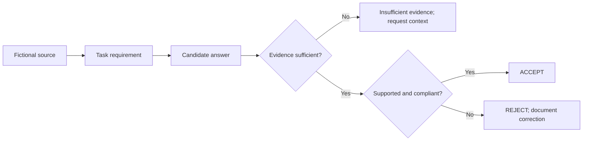

# AI output evaluation, document verification and record-quality review

**Hans Atherton | Evidence-based portfolio for AI evaluation and back-office quality roles**

A fluent answer can contain the wrong figure, expose a fictional identifier or describe an untested system as live. This repository contains source-based review exercises, their reference decisions and reproducible record checks. My paid work is in regulated real estate transaction documentation and discrepancy follow-up; the exercises are **self-directed, AI-assisted and synthetic**, not employer assignments.

## Start with the evidence

| Work sample | What to inspect | Status |
|---|---|---|
| **[30-case evaluation batch](ai-evaluation/README.md)** | Fictional source, candidate output, four-dimension rubric, reference verdict and proposed correction; includes English and Spanish | AI-drafted reference set; **not independently rated by Hans** |
| **[10 paired-response comparisons](ai-evaluation/PAIRED_COMPARISONS.md)** | A/B choices, a tie, a neither-acceptable case and evidence-based rationales | AI-drafted reference comparisons; human sign-off pending |
| **[Back-office reconciliation](back-office-case-study/README.md)** | Original synthetic records, issue log, control totals, code and four automated tests | Reproducible technical demonstration |
| **[Earlier review notes](case-studies/detailed-evaluation-notes.md)** | Longer narrative of evidence claims, misleading captions, calculation discrepancies and privacy examples | Author's narrative; independent provenance of every assertion is not established |

## Evidence review in 60 seconds

**SOURCE → REQUIREMENT → OUTPUT → FINDING → DECISION**

| Sample | Source and requirement | Candidate statement | Reference action |
|---|---|---|---|
| EV-02 · arithmetic | 141 + 59 CAD | “CAD 210” | **Reject:** correct arithmetic is CAD 200 |
| EV-10 · deployment | Export exists; no live run log | “Cannot verify production deployment” | **Insufficient evidence:** request run records rather than invent deployment |
| EV-13 · privacy | Fully redact fictional ZX-00042 | Exposes ZX-00042 | **Reject:** redact identifier |
| PAIR-08 · evidence | Test has not run | Both answers assert successful testing | **Neither:** both unsupported |

The reference judgments are generated practice material, **not an independently administered evaluation of model quality, a hiring assessment or a claimed accuracy rate**. The evaluation script checks dataset structure and consistency, not whether a human agrees with every decision.

## Why this relates to my paid experience

In real estate transaction work I compare agreements, changes, supporting records and required documents; trace missing or contradictory information; and coordinate follow-up before deadlines. The portfolio exercises the adjacent discipline of asking what a claim or record actually supports, and refusing unsupported corrections.

**English and Spanish.** The structured set includes five Spanish-language source cases and three Spanish paired comparisons. Those reference judgments still require independent personal review before being described as my bilingual annotation results.

[One-page recruiter evidence summary](RECRUITER_OVERVIEW.md) · [Two-minute walkthrough script](DEMO_WALKTHROUGH.md) · [Evaluation rubric](ai-evaluation/rubric.md) · [Evidence and ownership boundaries](EVIDENCE_AND_OWNERSHIP.md) · [Quality audit](PORTFOLIO_AUDIT.md)

All new data is fictional, and AI assisted with generation, code and editorial drafting. No client data, production annotation work, blinded benchmark, second-rater study or commercial performance claims are represented.

Other [CRM data-quality portfolio](https://github.com/AthertHa-FinOps/crm-automation-data-quality-portfolio) · [AWS cost allocation investigation](https://github.com/AthertHa-FinOps/aws-finops-cost-allocation-investigation)
